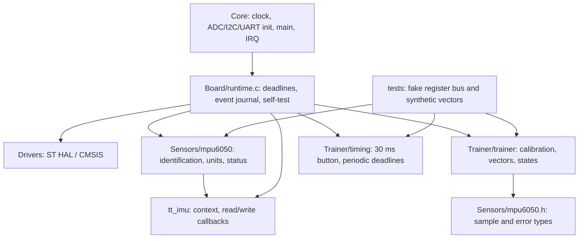

# Архітектура TiltTrainer

Board з'єднує переносимі модулі та HAL, зберігає knowledge of pinout. Sensors читає через callbacks із 7-bit адресою, не включає HAL. Trainer отримує фізичні одиниці, статус читання та explicit tick; не читає hardware. Калібрування і тренування обробляються одним state machine. Timing відокремлює контактну кнопку від політики калібрування та працює при uint32 wrap. Без RTOS, динамічного allocation і періодичних секундних затримок.

`tools/check_project.py` дозволяє переносимим модулям лише конкретні portable headers, забороняє HAL symbols, звіряє `.ioc` та wiring. Host compilation не потребує HAL. Core лишається місцем CubeMX init; main викликає Board у USER CODE. Перед регенерацією CubeMX зберігати власні каталоги й звіряти Makefile, `.ioc`, ADC init та USART2 IRQ.

Періоди MPU/ADC/телеметрії 20/100/200 мс. UART queue 2048 bytes і HAL interrupt TX не блокують main. Одна I2C операція має timeout 10 мс, ADC poll 2 мс. Fault-команди можуть додавати jitter; 60-секундний критерій FR-12 перевіряється без bus faults. Self-test має лише одноразове power-on settling 100 мс. Кнопка завжди опитується, її запити в CALIBRATING/SENSOR_ERROR не приймаються.

Кут обчислюється через `acosf` нормованого scalar product і clamp [-1,1]. Вікно п'яти векторів очищається на калібрування й невалідних читаннях. Cal mean/M2 використовує Welford; population variance кожної осі має бути не більшою 0.0004 g². GPIO LED залежить від TRAINING, валідності і OUTSIDE. UART `NA` показує відсутність актуального кута; темний LED не доводить WITHIN.
